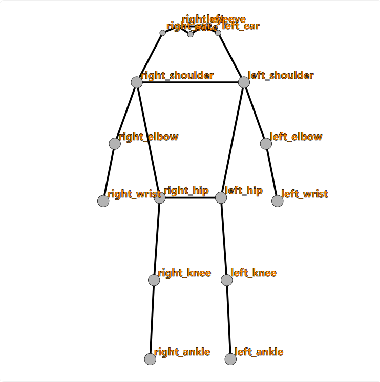
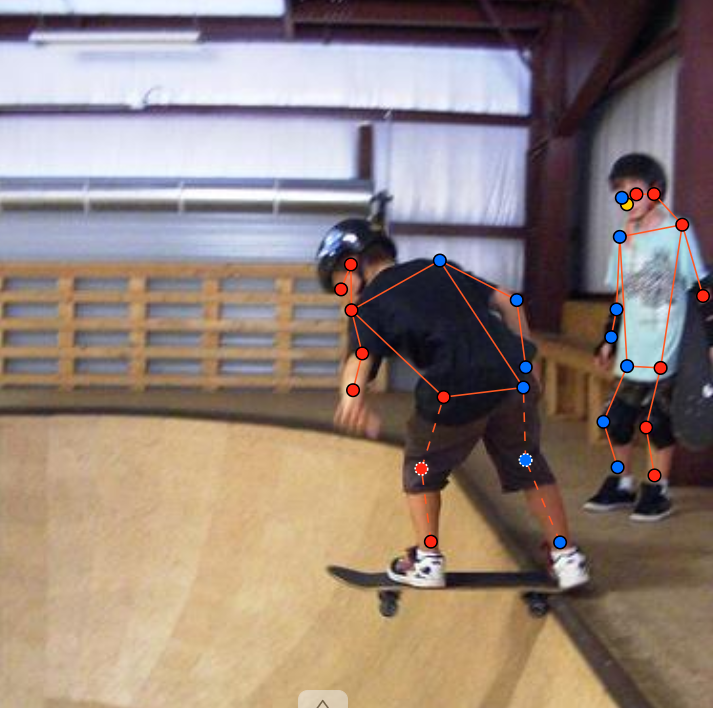
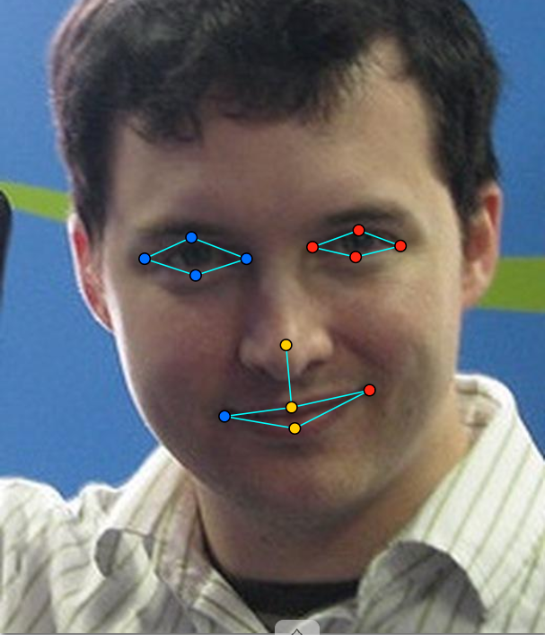
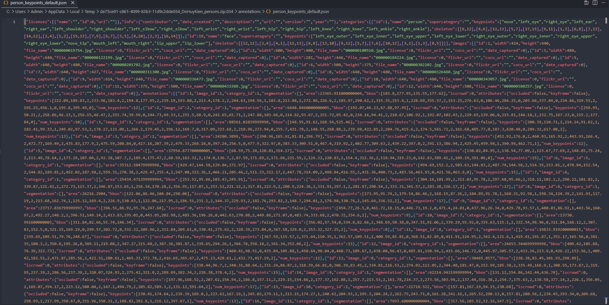

# Báo cáo cá nhân — DoHuyKien-2A202603216

Dữ liệu: 12 ảnh người COCO val2017 (Lin et al., 2014) và 8 ảnh chân dung từ ảnh COCO, chỉ dùng trong lớp.

## 0. Thông tin học viên

- Họ tên: Đỗ Huy Kiên
- MSSV: 2A202603216
- Email: dohuykien5205.kansy@gmail.com
- Link repository: https://github.com/dohuykienkansy/K5-L2-DAY04-DoHuyKien-2A202603216-KeypointPose-Student.git
- Phiên bản CVAT (Help → About): CVAT 2.82
- Máy: Windows · RAM 16 GB · chạy CVAT chế độ đầy đủ
- Bộ ảnh (`src/exports/assignment.json` do `lab.py setup` tạo): có
- Giờ bắt đầu: 16:54, ngày 12/11/2026 (theo thời điểm tạo `assignment.json`)
- Giờ kết thúc: 18:54, ngày 12/11/2026 (theo thời điểm cập nhật bản export cuối)

## 1. Kiểm tra label (CP0)

| Label | Kiểu | Số điểm | Tên điểm đúng bảng của lab? | Đúng thứ tự? | Số cạnh |
|---|---|---:|---|---|---:|
| `person` | Skeleton | 17 | Có | Có | 19 |
| `face` | Skeleton | 13 | Có | Có | 13 |

Mẫu `person` dựng theo người quay mặt về camera (các điểm `left_*` nằm bên phải khung mẫu)? **Có**

Cách đổi cờ `occluded` / `outside` cho **một điểm** trên phiên bản CVAT này (một câu):

Nhấp chuột phải vào điểm cần đổi cờ → chọn **Change occluded** (để đặt `v = 1`) hoặc **Change outside** (để đặt `v = 0`); hoặc chọn điểm rồi nhấn phím tắt tương ứng (`Q` cho occluded, `F` cho outside) trên bàn phím.

## 2. Số lượng đã gán và thời gian (CP1, CP2)

| Nhóm ảnh | Số ảnh | Số skeleton đã gán | Số người dưới 60 px (không gán) | Số poster / gương / màn hình bỏ qua | Thời gian (phút) |
|---|---:|---:|---:|---:|---:|
| `easy` | 5 | 5 | 0 | 0 | ~25 |
| `occluded` | 3 | 6 | 0 | 0 | ~21 |
| `back` | 2 | 4 | 0 | 0 | ~16 |
| `small` | 1 | 1 | 0 | 0 | ~8 |
| `crowd` | 1 | 3 | 0 | 0 | ~14 |
| `faces` | 8 | 8 | — | — | ~24 |

- Số ảnh người đã xong ở mốc phút 105: 8 / 10
- Thời gian thực tế (phút): CP1 ~84 · CP2 ~24 · CP3 ~20
- Ảnh tốn thời gian nhất là ảnh nào, vì sao?

Ảnh `000000326480.jpg` (nhóm `crowd`) tốn nhiều thời gian nhất (~14 phút) vì có 3 người đứng gần nhau, cần lần theo từng chi từ vai để phân biệt skeleton của từng người, tránh để đường nối vắt sang người khác. Một số điểm bị người khác che phải ước lượng và đặt cờ `occluded`.

## 3. Bảng ca khó (CP1, CP2)

Mỗi điểm bạn phân vân một dòng, nhất là phân vân giữa `v = 1` và `v = 0`, hoặc không chắc hướng người.

| Ảnh | Người / mặt | Điểm | Cờ đã chọn | Phân vân giữa | Lý do chọn |
|---|---|---|---:|---|---|
| `000000311300.jpg` | Person 1 (back) | `left_wrist`, `right_wrist` | `v = 0` | `v = 1` và `v = 0` | Người quay lưng, hai tay không nhìn thấy và không thể ước lượng chắc chắn vị trí cổ tay |
| `000000311300.jpg` | Person 2 (back) | `nose`, `left_eye`, `right_eye` | `v = 0` | `v = 1` và `v = 0` | Người quay lưng hoàn toàn, không thấy mặt và không đoán chắc được vị trí |
| `000000343057.jpg` | Person 1 | `left_ankle`, `right_ankle` | `v = 1` | `v = 1` và `v = 0` | Phần chân dưới bị che bởi xe đạp, nhưng có thể ước lượng vị trí cổ chân dựa vào hướng ống chân |
| `000000580257.jpg` | Person 2 | `left_ankle` | `v = 1` | `v = 1` và `v = 0` | Cổ chân bị bóng và phần xe che một phần, nhưng đoán được tương đối chắc từ hướng cẳng chân |
| `000000326480.jpg` | Person 3 | `left_hip`, `right_hip` | `v = 1` | `v = 1` và `v = 0` | Người đứng sau bị che phần hông bởi người trước, nhưng có thể ước lượng từ vai và gối |
| `face_41666.jpg` | Face 1 (tóc che) | `left_eye_upper`, `left_eye_lower`, `left_eye_outer` | `v = 0` | `v = 1` và `v = 0` | Mái tóc che phần lớn mắt trái, không thể ước lượng chính xác vị trí mí mắt và khóe ngoài |

## 4. Bảng tự review (CP3)

Đi từ ảnh cuối về ảnh đầu. 5 ảnh người (ít nhất 2 ảnh `back` hoặc `crowd`) và 3 ảnh mặt. Ít nhất 8 dòng, kể cả dòng `ok`. Ghi lỗi trước, sửa sau.

Mã lỗi dùng đúng một trong: `lr_swap`, `vis_flag`, `position`, `missing`, `extra`, `ok`.

| Ảnh | Người / mặt | Điểm | Mã lỗi | Ghi chú | Đã sửa? |
|---|---|---|---|---|---|
| `000000326480.jpg` (crowd) | Person 3 | `left_shoulder` | `position` | Điểm vai trái lệch xuống dưới khoảng 4 px so với tâm khớp thật | Có |
| `000000311300.jpg` (back) | Person 1 | `left_ear`, `right_ear` | `lr_swap` | Người quay lưng, tai trái/phải ban đầu đặt ngược; sửa lại theo hướng nghiêng của đầu | Có |
| `000000431988.jpg` (back) | Person 2 | `left_knee`, `right_knee` | `ok` | Đã kiểm, gối trái/phải đúng theo người quay lưng, đường nối bình thường | — |
| `000000343057.jpg` (easy) | Person 1 | `left_ankle`, `right_ankle` | `vis_flag` | Script cảnh báo cặp ankle có thể ngược chiều; kiểm lại — người đang đạp xe, chân bắt chéo thật, giữ nguyên | Không sửa (chân bắt chéo thật) |
| `000000580257.jpg` (occluded) | Person 1 | Toàn bộ | `ok` | Kiểm lại trái/phải và cờ, không phát hiện lỗi | — |
| `face_301643.jpg` (kính râm) | Face 1 | `left_eye_*`, `right_eye_*` (4 điểm) | `vis_flag` | Ban đầu đặt `v = 2` cho mắt sau tròng kính râm; đã sửa thành `occluded` (`v = 1`) | Có |
| `face_356144.jpg` (nghiêng) | Face 1 | `right_eye_outer`, `right_eye_inner` | `ok` | Mắt xa bị sống mũi che một phần, đã đặt `occluded`; kiểm lại thấy đúng | — |
| `face_41666.jpg` (tóc che) | Face 1 | `left_eye_outer`, `left_eye_upper`, `left_eye_lower` | `ok` | Đã đặt `outside` (`v = 0`) vì tóc che hoàn toàn, không ước lượng được; đúng quy tắc | — |

Tổng hợp số lỗi theo mã:

| `lr_swap` | `vis_flag` | `position` | `missing` | `extra` | `ok` |
|---:|---:|---:|---:|---:|---:|
| 1 | 2 | 1 | 0 | 0 | 4 |

Điểm còn phân vân giữa `v = 1` và `v = 0` (ghi cả hai lựa chọn và lý do chọn):

- `000000343057.jpg` — `left_ankle`, `right_ankle`: Script đưa ra cảnh báo `lr_swap` cho cặp ankle. Sau khi xem lại, người đang đạp xe nên hai chân bắt chéo thật. Chọn giữ nguyên vị trí và cờ `v = 1` vì vị trí ước lượng được từ hướng bàn chân trên bàn đạp.
- `000000580257.jpg` — `left_ankle` (Person 2): Phân vân `v = 1` và `v = 0`. Chọn `v = 1` vì dù bị xe che một phần, đầu gối và cẳng chân còn thấy nên có thể ước lượng vị trí cổ chân tương đối chắc.

## 5. Kiểm file xuất và kết quả tự kiểm (CP4)

Tự kiểm tay trong file JSON:

| File | Người / mặt kiểm (ảnh, thứ tự) | Số phần tử `keypoints` | Điểm `outside` ra `v = 0`, `occluded` ra `v = 1`? | `num_keypoints` khớp? |
|---|---|---:|---|---|
| `DoHuyKien_persons.zip` | `000000019754.jpg`, person #1 | 51 | Có (left_hip, right_hip, left_knee, left_ankle, right_ankle ra v=0; left_shoulder, left_wrist ra v=1) | Có (num_keypoints=12) |
| `DoHuyKien_persons.zip` | `000000336477.jpg`, person #14 | 51 | Có (right_ear ra v=1; v=2 cho các điểm còn lại) | Có (num_keypoints=17) |
| `DoHuyKien_faces.zip` | `face_257657.jpg`, face #1 | 39 | Có (tất cả v=2, không có điểm bị che) | Có (num_keypoints=13) |

Sau khi xuất, CVAT ghi `occluded` thành `v = 1` và `outside` thành `v = 0`. Tọa độ của điểm `outside` trong file là **tọa độ cũ** (CVAT 2.x xuất tọa độ cũ, không phải `0, 0`; không phải lỗi — điểm `v = 0` bị bỏ qua khi huấn luyện và chấm).

Hai job đã chuyển sang completed trên CVAT? *(điền Có / Không sau khi hoàn thành bước này)*

Dán phần **TÓM TẮT** in ra từ `src/check_submission.py`:

```text
----- TÓM TẮT (dán vào báo cáo mục 5) -----
- File person: DoHuyKien_persons.zip
  Số ảnh: 12 · số skeleton `person`: 19 · mỗi annotation 51 số
  Skeleton theo ảnh: 000000019754=1, 000000100510=1, 000000122199=2, 000000184224=1, 000000201702=1, 000000302102=2, 000000311300=2, 000000326480=3, 000000336477=1, 000000343057=1, 000000431988=2, 000000580257=2
  Cờ v: v=2 212 (66%) · v=1 42 (13%) · v=0 69 (21%)
  num_keypoints trung bình: 13.4
- File face: DoHuyKien_faces.zip
  Số ảnh: 8 · số skeleton `face`: 8 · mỗi annotation 39 số
  Skeleton theo ảnh: face_257657=1, face_300399=1, face_301643=1, face_342273=1, face_356144=1, face_41666=1, face_79591=1, face_92028=1
  Cờ v: v=2 101 (97%) · v=1 0 (0%) · v=0 3 (3%)
  num_keypoints trung bình: 12.6
- Ghi chú: 72 điểm v = 0 vẫn mang tọa độ cũ (CVAT 2.x xuất như vậy; chuẩn COCO ghi 0, 0). Không phải lỗi: điểm v = 0 bị bỏ qua khi huấn luyện và khi chấm.
- Số [LỖI]: 0 · số [CẢNH BÁO]: 2
Kết quả: ĐẠT (đọc lại từng cảnh báo ở trên)
```

Các `[CẢNH BÁO]` còn giữ nguyên và lý do:

- **`000000343057.jpg` — cặp ankle ngược chiều:** Script cảnh báo cặp ankle có thể bị `lr_swap`. Sau khi xem lại ảnh, người trong ảnh đang đạp xe với tư thế chân bắt chéo thật (một chân đang đạp xuống, một chân đang kéo lên). Giữ nguyên vì đây là tư thế thật của người, không phải lỗi gán nhãn.
- **`000000580257.jpg` — cặp ankle ngược chiều:** Tương tự, người đang bước đi với bước chân rộng khiến projection 2D của hai cổ chân có thể trông bắt chéo. Kiểm lại theo hướng di chuyển của thân người, giữ nguyên.

## 6. Ảnh chụp màn hình

1. Label `person` trong label constructor (đủ 17 điểm có tên):

   

2. Một người quay lưng đã gán, cờ đã đặt:

   

3. Một khuôn mặt đã gán 13 điểm, phóng to vùng mắt:

   

4. Một đoạn JSON xuất của một người:

   

Nguồn ảnh: COCO val2017 / train2017 (Lin et al., 2014), CC BY / CC BY-SA.

## 7. Tự đánh giá

1. **Lỗi bạn mắc nhiều nhất hôm nay, và cách bạn sẽ tránh ở dự án thật:**

   Lỗi hay mắc nhất là **`vis_flag`** — đặt sai cờ cho các điểm bị che, nhất là mắt sau kính râm (đặt `v = 2` thay vì `v = 1`). Ở dự án thật, tôi sẽ tạo checklist riêng cho từng loại ảnh đặc biệt (kính râm, mặt nghiêng, người quay lưng) và bật tên điểm khi review để không bỏ sót.

2. **Một quy tắc tôi đề xuất thêm vào guideline:**

   Nên bổ sung quy tắc cho trường hợp **người trong tư thế yoga hoặc võ thuật**: khi thân người uốn cong bất thường, đường nối vai–hông–gối bắt chéo nhau hoàn toàn hợp lệ, nhưng trông rất giống lỗi `lr_swap`. Đề xuất thêm mục "Tư thế đặc biệt" vào bảng ca khó kèm ví dụ ảnh.

3. **Nhãn của tôi đi vào model ở đâu? Lỗi `lr_swap` ảnh hưởng thế nào:**

   Nhãn keypoint của tôi tạo thành **heatmap mục tiêu** cho từng điểm (một đỉnh Gaussian tại tọa độ `(x, y)` với bán kính theo `σ` của COCO). Lỗi `lr_swap` ở tai (tôi đã sửa trong ảnh `000000311300.jpg`) sẽ gây ra hai tác hại: (1) Heatmap mục tiêu cho `left_ear` nằm ở **bên phải** ảnh thay vì bên trái, model học ngược; (2) Trong bước **lật ảnh tăng dữ liệu**, CVAT đổi tên `left_ear` ↔ `right_ear` — nếu tên đã bị hoán đổi từ trước, lật ảnh lại hoán đổi ngược lại thành đúng, khiến model học không nhất quán và OKS sụp đổ.

## 8. Khó khăn và lỗi kỹ thuật

- **Ảnh `small` (`000000100510.jpg`):** Người trong ảnh khá nhỏ và nền phức tạp, cần phóng to tối đa để đặt điểm đầu và mặt chính xác.
- **Ảnh `crowd` (`000000326480.jpg`):** Ba người đứng gần nhau, vai và tay chồng lên nhau. Phải lần theo từng chi từ vai để tránh nhầm cánh tay người này với người kia.
- **Kính râm (`face_301643.jpg`):** Ban đầu không để ý đặt `v = 2` cho mắt sau tròng kính tối; phát hiện khi tự review CP3 và đã sửa thành `occluded`.
- Không gặp lỗi kỹ thuật với CVAT hay Docker trong buổi này.

## Bonus (nếu làm)

### B1 — 3 ảnh người khó thêm

| Ảnh | Số skeleton | Số người dưới 60 px | Ca khó nhất |
|---|---:|---:|---|
| `000000065350.jpg` | *(điền)* | *(điền)* | *(điền)* |
| `000000213506.jpg` | *(điền)* | *(điền)* | *(điền)* |
| `000000507223.jpg` | *(điền)* | *(điền)* | *(điền)* |

Kết quả `src/check_submission.py` cho `DoHuyKien_bonus_persons.zip`:

```text
(dán kết quả script ở đây)
```

### B2 — 5 ảnh khuôn mặt đen trắng / hồng ngoại

Ảnh không màu khó hơn ở điểm nào? Kính râm trên ảnh hồng ngoại có còn là `v = 1` không?

*(điền nội dung cho bonus B2)*

### B3 — Model so với nhãn của tôi (không tính điểm)

- Demo đã dùng:
- Ảnh đã thử:

1. Model có trả điểm cho khớp bị che, hay khớp ngoài ảnh không? Confidence ở các điểm đó thế nào?

   ...

2. Với người quay lưng, model có đổi trái/phải không?

   ...

3. Bộ điểm của model có giống 17 điểm COCO không?

   ...

## 9. Tài liệu tham khảo và công cụ AI đã dùng

- Lin, T.-Y. et al. (2014). Microsoft COCO: Common Objects in Context. ECCV 2014. Nguồn ảnh: COCO train2017 / val2017.
- Tài liệu lab: `docs/GUIDELINE.md`, `docs/CVAT_CHEATSHEET.md`, `docs/COCO_KEYPOINTS.md`.
- Không dùng AI để tra tọa độ điểm hay chép từ annotation COCO gốc.
